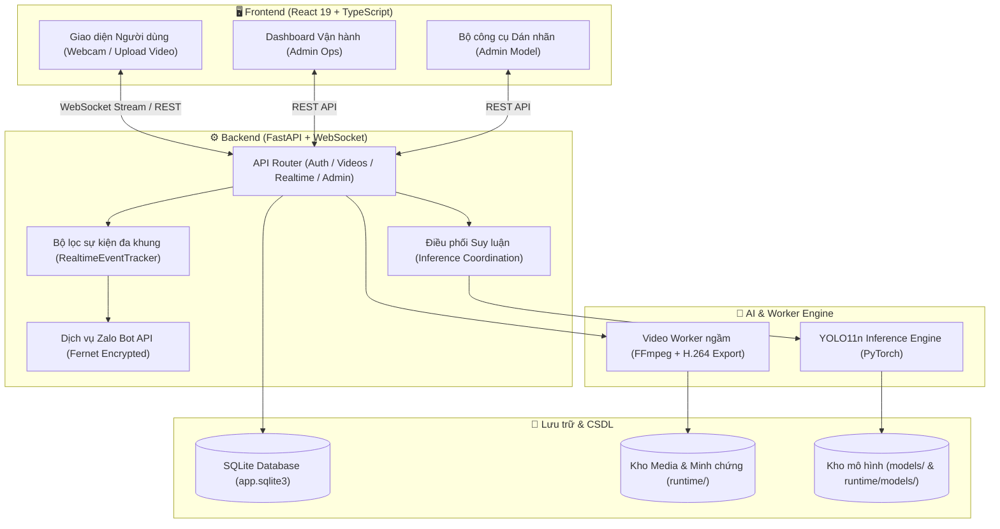

# FLARE — Fire Location And Recognition Engine

<div align="center">

**Hệ thống giám sát, phát hiện hỏa hoạn (lửa & khói) thời gian thực và quản lý vòng đời mô hình AI**

[](https://www.python.org/)
[](https://fastapi.tiangolo.com/)
[](https://react.dev/)
[](https://docs.ultralytics.com/)
[](https://vitejs.dev/)
[](https://cryptography.io/)
[](#)

</div>

---

## 📖 1. Giới thiệu tổng quan

**FLARE (Fire Location And Recognition Engine)** là hệ thống cảnh báo hỏa hoạn thời gian thực được xây dựng phục vụ đồ án Khóa luận tốt nghiệp. Hệ thống kết hợp mạng nơ-ron phát hiện vật thể tiên tiến **YOLO11** (Ultralytics) cùng kiến trúc web hiện đại **FastAPI + React 19**, mang lại giải pháp cảnh báo cháy nổ tự động với độ trễ cực thấp.

### Điểm nổi bật:
- ⚡ **Webcam Trực tiếp (Realtime Stream):** Truyền và suy luận luồng webcam laptop trực tiếp qua giao thức WebSocket hai chiều, hiển thị song song camera gốc và luồng có bounding box với độ trễ dưới 50ms.
- 📹 **Phân tích Video Tải lên (Async Video Processing):** Cho phép người dùng tải lên video MP4 (tối đa 4K 60FPS) để xử lý ngầm, trích xuất khung hình có box, phân đoạn sự kiện và tua video thông minh.
- 📲 **Cảnh báo tức thời qua Zalo Bot:** Tự động kích hoạt thông báo kèm ảnh minh chứng và vị trí hỏa hoạn tới Zalo của người dùng khi sự kiện cháy/khói được xác nhận bởi thuật toán theo dõi đa khung (`RealtimeEventTracker`).
- 🔄 **Vòng lặp học chủ động (Human-in-the-Loop Active Learning):** Người dùng có thể báo sai trực tiếp trên từng khung hình; Admin Mô hình có công cụ trực quan để chỉnh sửa, vẽ lại box và xuất bộ dữ liệu chuẩn định dạng YOLO.
- 🛡️ **Kiến trúc phân quyền chặt chẽ:** Tách biệt rõ ràng 3 phân hệ: Người dùng (`user`), Quản trị vận hành (`admin_ops`) và Quản trị mô hình (`admin_model`).

---

## 🏛️ 2. Kiến trúc hệ thống (System Architecture)



---

## 🛠️ 3. Công nghệ sử dụng (Tech Stack)

| Thành phần | Công nghệ / Thư viện | Vai trò |
|---|---|---|
| **AI / Computer Vision** | `Ultralytics YOLO11n`, `PyTorch`, `OpenCV` | Huấn luyện và suy luận phát hiện lửa (`lua` - Class 1) và khói (`khoi` - Class 0) |
| **Backend API** | `FastAPI`, `Uvicorn`, `WebSockets` | Cung cấp RESTful API hiệu năng cao và luồng truyền ảnh realtime qua WebSocket |
| **CSDL & ORM** | `SQLAlchemy 2.0`, `SQLite` | Quản lý dữ liệu người dùng, phiên webcam, tác vụ video, sự kiện cảnh báo và phiên bản mô hình |
| **Bảo mật & Mã hóa** | `Argon2-cffi`, `Cryptography (Fernet)` | Băm mật khẩu chuẩn kháng tấn công GPU, mã hóa bảo mật Bot Token Zalo |
| **Frontend** | `React 19`, `TypeScript`, `Vite 6` | Giao diện Single Page Application hiện đại, tối ưu hóa tái kết xuất ở tần số cao |
| **Design System** | `Fira Sans` + `Fira Code`, UI UX Pro Max & Impeccable Craft Floor | Bảng điều khiển giám sát chuẩn SOC/Telemetry với độ tương phản cao |
| **Đa phương tiện** | `FFmpeg`, `imageio-ffmpeg` | Đọc, giải mã video MP4 và xuất video kết quả chuẩn codec H.264/AAC |

---

## ⚙️ 4. Yêu cầu môi trường & Cài đặt

### Yêu cầu hệ thống:
- **Hệ điều hành:** Windows 10/11, Linux, hoặc macOS.
- **Python:** Phiên bản `3.11+`
- **Node.js:** Phiên bản `20.19+` hoặc `22.12+` (kèm npm).
- **Phần cứng:** CPU tối thiểu 4 nhân (khuyến nghị có GPU NVIDIA CUDA nếu muốn suy luận video 4K).

### Hướng dẫn cài đặt từng bước:

#### Bước 1: Clone mã nguồn
```powershell
git clone https://github.com/<your-username>/Real_Time_Smoke_Fire_Detection_YOLO.git
cd Real_Time_Smoke_Fire_Detection_YOLO
```

#### Bước 2: Khởi tạo môi trường ảo Python & Cài thư viện Backend
```powershell
# Tạo môi trường ảo
python -m venv .venv

# Kích hoạt môi trường và cài đặt dependencies
.\.venv\Scripts\python.exe -m pip install --upgrade pip
.\.venv\Scripts\python.exe -m pip install -r backend\requirements.txt
```

#### Bước 3: Cài đặt thư viện Frontend
```powershell
cd frontend
npm install
cd ..
```

#### Bước 4: Cấu hình biến môi trường
Sao chép file cấu hình mẫu `.env.example` thành `.env`:
```powershell
Copy-Item .env.example .env
```
*(Mặc định hệ thống đã có thiết lập chuẩn để chạy thử nghiệm trên `localhost`. Nếu kết nối Zalo Bot đính kèm ảnh công khai, cấu hình thêm biến `PUBLIC_API_ORIGIN` trỏ đến địa chỉ tunnel HTTPS của bạn).*

#### Bước 5: Đặt checkpoint mô hình ban đầu
Đảm bảo file trọng số `best.pt` của phiên bản YOLO11n V6 được đặt tại:
```text
models/yolo11n-v6/best.pt
```

---

## 🚀 5. Khởi chạy ứng dụng (Quick Start)

Hệ thống hoạt động với 3 tiến trình phối hợp độc lập. Mở **3 cửa sổ PowerShell** tại thư mục gốc của dự án:

### Cửa sổ 1: Khởi động Backend API Server
```powershell
.\.venv\Scripts\python.exe -m uvicorn backend.app.main:app --host localhost --port 8000 --reload
```
*(Kiểm tra kết nối API: `http://localhost:8000/api/health`)*

### Cửa sổ 2: Khởi động Video Worker (Tiến trình xử lý video ngầm)
```powershell
.\.venv\Scripts\python.exe -m backend.app.worker
```
*(Tiến trình này nhận tác vụ từ hàng chờ, điều phối FFmpeg và suy luận YOLO trên từng frame video).*

### Cửa sổ 3: Khởi động Frontend Dev Server
```powershell
cd frontend
npm run dev
```

Truy cập hệ thống tại: **`http://localhost:5173`**

---

## 👤 6. Phân quyền & Khởi tạo tài khoản Quản trị viên

Hệ thống tuân thủ nguyên tắc bảo mật: **Tài khoản quản trị viên không được phép đăng ký tự do qua giao diện Web**. Chúng được tạo riêng biệt thông qua công cụ dòng lệnh (CLI):

```powershell
# 1. Tạo tài khoản Quản trị Vận hành (admin_ops)
.\.venv\Scripts\python.exe -m backend.app.cli create-admin-ops --username admin_ops

# 2. Tạo tài khoản Quản trị Mô hình (admin_model)
.\.venv\Scripts\python.exe -m backend.app.cli create-admin-model --username admin_model
```
*(Mật khẩu sẽ được yêu cầu nhập bảo mật trực tiếp trên terminal).*

- **Người dùng (`user`):** Tự đăng ký trực tiếp trên giao diện Đăng ký của trang Web.
- **Admin Vận hành (`admin_ops`):** Giám sát toàn bộ luồng cảnh báo từ video và webcam, quản trị tài khoản người dùng, xem báo cáo đánh giá và phê duyệt kích hoạt/rollback model.
- **Admin Mô hình (`admin_model`):** Tiếp nhận danh sách phản hồi, sử dụng công cụ canvas để vẽ lại hoặc xác nhận bounding box đúng, xuất dataset phục vụ huấn luyện bù (Active Learning).

---

## 📱 7. Hướng dẫn kết nối Bot Zalo Cảnh báo

1. Mở ứng dụng Zalo, tìm bot cảnh báo hỏa hoạn của hệ thống và gửi tin nhắn `/start`.
2. Đăng nhập tài khoản của bạn trên Web, vào mục **Hồ sơ và Zalo**.
3. Dán **Bot Token** vào ô cấu hình và bấm **"Kết nối bot Zalo"**.
4. Backend tự động gọi API Zalo xác minh cuộc trò chuyện, gửi tin nhắn thử nghiệm và lưu trữ Token dưới dạng mã hóa đối xứng Fernet trong CSDL.
5. Khi webcam hoặc video phát hiện cháy/khói vượt ngưỡng an toàn, bot Zalo sẽ lập tức gửi tin nhắn thông báo kèm thông tin người gửi, thời gian và ảnh minh chứng có bounding box.

---

## 🔒 8. Cam kết Bảo mật & Quyền riêng tư (Security & Privacy)

- **Nguyên tắc riêng tư Webcam:** Hệ thống **tuyệt đối không quay lén hoặc lưu trữ video webcam** của người dùng. Khung hình webcam chỉ được truyền lên RAM máy chủ để suy luận theo từng frame. Chỉ duy nhất ảnh tại thời điểm chốt cảnh báo hoặc ảnh người dùng chủ động gửi phản hồi mới được lưu trữ làm minh chứng.
- **Bảo mật thông tin xác thực:** Mật khẩu được mã hóa bằng thuật toán kháng tấn công brute-force `Argon2id`. Session token lưu dưới dạng chuỗi băm an toàn. Token Zalo của người dùng được mã hóa bằng thuật toán `Fernet (AES-128-CBC)`.
- **Cơ chế điều phối chống nghẽn CPU:** Khi một tác vụ video tải lên đang phân tích, hệ thống tự động điều tiết tần số gửi frame từ webcam để đảm bảo server không bị treo hoặc tràn bộ nhớ.

---

## 📂 9. Cấu trúc thư mục dự án

```text
Real_Time_Smoke_Fire_Detection_YOLO/
├── backend/
│   ├── app/
│   │   ├── api/                 # Endpoints REST API & WebSocket (admin, user, realtime, auth)
│   │   ├── inference/           # Thuật toán làm mịn box, theo dõi sự kiện và điều phối model
│   │   ├── worker/              # Worker tiến trình ngầm xử lý phân tích và xuất video MP4
│   │   ├── bootstrap.py         # Khởi tạo CSDL SQLite và nạp cấu hình ban đầu
│   │   ├── cli.py               # Lệnh CLI quản trị hệ thống (tạo admin)
│   │   ├── config.py            # Cấu hình biến môi trường
│   │   ├── models.py            # ORM Database Models (SQLAlchemy)
│   │   ├── security.py          # Module mã hóa Argon2 & Fernet
│   │   └── zalo.py              # Tích hợp Zalo Bot API
│   └── requirements.txt         # Danh mục thư viện Python
├── frontend/
│   ├── src/
│   │   ├── AnnotationEditor.tsx # Công cụ canvas SVG vẽ và chỉnh sửa bounding box
│   │   ├── App.tsx              # Component trung tâm và điều hướng giao diện các phân hệ
│   │   ├── api.ts               # HTTP client kết nối backend
│   │   ├── styles.css           # Design Tokens & Stylesheet Dark Slate SOC
│   │   └── types.ts             # Định nghĩa kiểu dữ liệu TypeScript
│   ├── package.json
│   └── vite.config.ts
├── models/
│   └── yolo11n-v6/              # Checkpoint khởi đầu và metadata mô hình
├── notebooks/                   # Jupyter Notebooks tiền xử lý dữ liệu và huấn luyện Kaggle
├── scripts/                     # Scripts kiểm định dữ liệu và tiền xử lý
├── .env.example                 # Mẫu cấu hình biến môi trường
├── .gitignore                   # Quy tắc loại trừ tệp nhạy cảm và artifacts nặng
└── README.md                    # Tài liệu hướng dẫn chính
```

---

## 📜 10. Giấy phép & Tác giả

- **Đồ án Khóa luận tốt nghiệp:** Hệ thống phát hiện hỏa hoạn thời gian thực bằng YOLO11 (Real-Time Smoke & Fire Detection System).
- **Tác giả:** Nguyễn Thanh Quyến (`quyen123`)
- **Giấy phép:** [MIT License](LICENSE)
