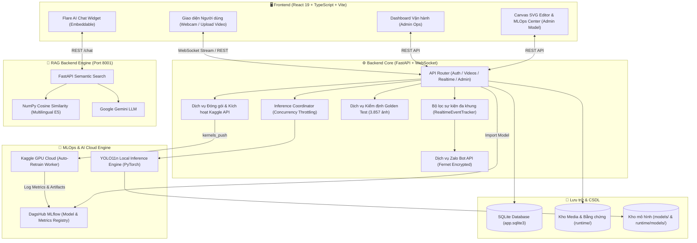
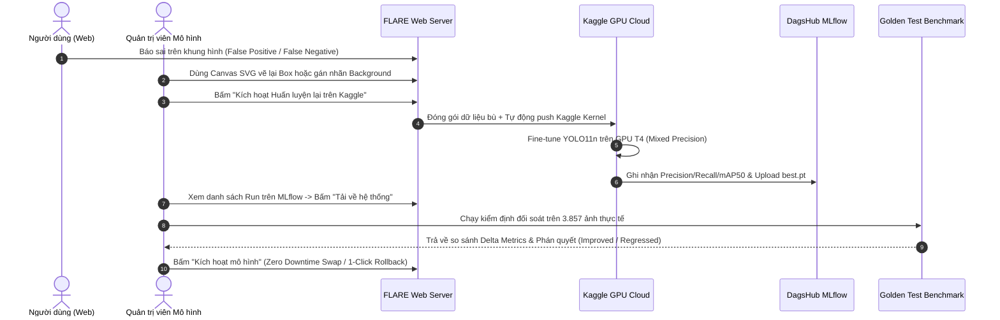

# FLARE — Fire Location And Recognition Engine

<div align="center">

**Hệ thống Giám sát, Phát hiện Hỏa hoạn (Lửa & Khói) Thời Gian Thực, Quản lý Vòng đời MLOps & Trợ lý An toàn PCCC Thông minh**

[](https://www.python.org/)
[](https://fastapi.tiangolo.com/)
[](https://react.dev/)
[](https://docs.ultralytics.com/)
[](https://dagshub.com/)
[](https://www.kaggle.com/)
[](#-9-trợ-lý-thông-minh-flare-ai-local-rag-assistant)
[](https://cryptography.io/)
[](#)

</div>

---

## 📖 1. Giới thiệu tổng quan

**FLARE (Fire Location And Recognition Engine)** là hệ thống cảnh báo hỏa hoạn thời gian thực kết hợp quản lý toàn diện vòng đời mô hình học máy (MLOps), được nghiên cứu và phát triển phục vụ đồ án Khóa luận tốt nghiệp. 

Hệ thống kết hợp mạng nơ-ron tích chập phát hiện vật thể tiên tiến **YOLO11** (Ultralytics) cùng kiến trúc fullstack hiện đại **FastAPI + React 19 + TypeScript**, mang lại giải pháp cảnh báo cháy nổ tự động với độ trễ cực thấp, khả năng tự học cải thiện liên tục (Continual Learning) và trợ lý ảo hỏi đáp PCCC tích hợp.

### Điểm nổi bật của hệ thống:
- ⚡ **Webcam Trực tiếp (Realtime Stream):** Truyền và suy luận luồng webcam laptop trực tiếp qua giao thức WebSocket hai chiều, hiển thị song song camera gốc và luồng có bounding box với độ trễ dưới 50ms.
- 📹 **Phân tích Video Tải lên (Async Video Processing):** Cho phép tải lên video MP4 (tối đa 4K 60FPS) để xử lý ngầm, trích xuất khung hình có box, phân đoạn sự kiện và tua video thông minh.
- 📲 **Cảnh báo tức thời qua Zalo Bot:** Tự động gửi thông báo kèm ảnh minh chứng và vị trí hỏa hoạn tới Zalo của người dùng khi sự kiện cháy/khói được xác nhận bởi thuật toán theo dõi đa khung (`RealtimeEventTracker`).
- 🤖 **Trợ lý AI PCCC & Vận hành (Flare AI Assistant):** Nhúng Chat Widget RAG (Retrieval-Augmented Generation) thông minh, phân quyền đa vai trò, tra cứu quy chuẩn PCCC (C07 Bộ Công an, 114) và cách ly lịch sử trò chuyện theo từng tài khoản.
- 🔄 **Chu trình MLOps Khép kín (Human-in-the-Loop Active Learning):** Tiếp nhận phản hồi báo sai từ người dùng, công cụ Canvas SVG vẽ lại bounding box, tự động đóng gói dữ liệu và gọi Kaggle GPU API huấn luyện bù, đồng bộ metrics và checkpoint lên DagsHub MLflow.
- 🧪 **Bộ kiểm định đối soát Golden Test Set (3.857 ảnh):** Tự động đánh giá mô hình mới trên tập kiểm định thực tế khắt khe, đưa ra phán quyết tự động (*Improved* vs *Regressed*), hỗ trợ Kích hoạt thay thế tức thời (Zero Downtime) và Rollback 1-click.

---

## 🏛️ 2. Kiến trúc hệ thống (System Architecture)



---

## 🛠️ 3. Công nghệ sử dụng (Tech Stack)

| Phân hệ | Công nghệ / Thư viện | Vai trò trong hệ thống |
|---|---|---|
| **AI / Computer Vision** | `Ultralytics YOLO11n`, `PyTorch 2.11`, `OpenCV` | Huấn luyện và suy luận phát hiện lửa (`lua` - Class 1) và khói (`khoi` - Class 0) |
| **Backend API** | `FastAPI 0.111`, `Uvicorn`, `WebSockets` | RESTful API hiệu năng cao và luồng truyền ảnh webcam trực tiếp qua WebSocket |
| **CSDL & ORM** | `SQLAlchemy 2.0`, `SQLite (WAL Mode)` | Quản lý người dùng, phiên webcam, tác vụ video, sự kiện cảnh báo và phiên bản mô hình |
| **Bảo mật & Mã hóa** | `Argon2id`, `Cryptography (Fernet)` | Băm mật khẩu chuẩn kháng GPU, mã hóa đối xứng AES-128 lưu trữ Zalo Bot Token |
| **MLOps Cloud** | `DagsHub MLflow 2.18`, `Kaggle API 2.2` | Theo dõi tham số/metrics, quản lý Model Registry, tự động kích hoạt GPU huấn luyện lại |
| **Trợ lý AI (RAG)** | `Google Gemini`, `sentence-transformers (E5)` | Chatbot RAG phân quyền, tra cứu ngữ nghĩa tài liệu PCCC và hướng dẫn vận hành |
| **Frontend SPA** | `React 19`, `TypeScript`, `Vite 6` | Giao diện Single Page Application hiện đại, tối ưu hóa render ở tần số khung hình cao |
| **Thiết kế & Giao diện** | `Fira Sans` + `Fira Code`, Dark Slate SOC | Bảng điều khiển giám sát an toàn với độ tương phản cao, tuân thủ Impeccable Craft Floor |
| **Đa phương tiện** | `FFmpeg`, `imageio-ffmpeg` | Đọc, giải mã video MP4 đa luồng và xuất video kết quả chuẩn codec H.264/AAC |

---

## ⚙️ 4. Yêu cầu môi trường & Cài đặt

### Yêu cầu hệ thống:
- **Hệ điều hành:** Windows 10/11, Linux (Ubuntu 20.04+), hoặc macOS.
- **Python:** Phiên bản `3.11+`
- **Node.js:** Phiên bản `20.19+` hoặc `22.12+` (kèm npm).
- **Phần cứng:** CPU tối thiểu 4 nhân, RAM 8GB (khuyến nghị GPU NVIDIA CUDA để tăng tốc suy luận).

### Hướng dẫn cài đặt từng bước:

#### Bước 1: Clone mã nguồn
```powershell
git clone https://github.com/<your-username>/Real_Time_Smoke_Fire_Detection_YOLO.git
cd Real_Time_Smoke_Fire_Detection_YOLO
```

#### Bước 2: Khởi tạo môi trường ảo Python & Cài thư viện Backend
```powershell
# Tạo môi trường ảo
python -m venv .venv

# Kích hoạt môi trường và cài đặt dependencies
.\.venv\Scripts\python.exe -m pip install --upgrade pip
.\.venv\Scripts\python.exe -m pip install -r backend\requirements.txt
```

#### Bước 3: Cài đặt thư viện Frontend
```powershell
cd frontend
npm install
cd ..
```

#### Bước 4: Cấu hình biến môi trường
Sao chép file cấu hình mẫu `.env.example` thành `.env`:
```powershell
Copy-Item .env.example .env
```
Mở file `.env` và điền các thông tin:
```ini
APP_ORIGIN=http://localhost:5173
API_ORIGIN=http://localhost:8000
PUBLIC_API_ORIGIN=

# Cấu hình DagsHub MLflow (Dành cho Admin Model)
MLFLOW_TRACKING_URI=https://dagshub.com/<username>/<repo>.mlflow
MLFLOW_TRACKING_USERNAME=<your_dagshub_username>
MLFLOW_TRACKING_PASSWORD=<your_dagshub_token>

# Cấu hình Kaggle API (Dành cho tính năng 1-Click Retrain)
KAGGLE_USERNAME=<your_kaggle_username>
KAGGLE_API_TOKEN=<your_kaggle_key>
```

#### Bước 5: Kiểm tra Checkpoint mô hình Baseline
Hệ thống đã chuẩn hóa mô hình gốc ban đầu tại:
```text
models/final_sfd_yolo11n/
├── best.pt               # Trọng số YOLO11n đã huấn luyện
├── labelmap.json         # Danh mục nhãn (0: khoi, 1: lua)
└── run_summary.json      # Báo cáo tham số và metrics gốc
```

---

## 🚀 5. Khởi chạy ứng dụng (Quick Start)

Mở các cửa sổ terminal tại thư mục gốc của dự án:

### Cửa sổ 1: Khởi động Backend API Server (FastAPI)
```powershell
.\.venv\Scripts\python.exe -m uvicorn backend.app.main:app --host localhost --port 8000 --reload
```
*(Kiểm tra kết nối: `http://localhost:8000/api/health`)*

### Cửa sổ 2: Khởi động Video Worker ngầm
```powershell
.\.venv\Scripts\python.exe -m backend.app.worker
```
*(Tiến trình này nhận tác vụ từ SQLite Queue, chạy suy luận YOLO và xuất video MP4 gắn box).*

### Cửa sổ 3: Khởi động Frontend Dev Server (React 19)
```powershell
cd frontend
npm run dev
```

Truy cập hệ thống tại: **`http://localhost:5173`**

*(Tùy chọn) Nếu sử dụng Trợ lý Flare AI Chatbot, khởi chạy thêm backend RAG tại cổng 8001:*
```powershell
# Chạy trong thư mục dự án LOCAL-RAG
docker compose up -d
```

---

## 👤 6. Phân quyền & Khởi tạo tài khoản Quản trị viên

Hệ thống thiết lập nguyên tắc bảo mật: **Tài khoản quản trị viên không được phép đăng ký qua giao diện Web**. Chúng được tạo riêng biệt thông qua công cụ dòng lệnh (CLI):

```powershell
# 1. Tạo tài khoản Quản trị Vận hành (admin_ops)
.\.venv\Scripts\python.exe -m backend.app.cli create-admin-ops --username admin_ops

# 2. Tạo tài khoản Quản trị Mô hình (admin_model)
.\.venv\Scripts\python.exe -m backend.app.cli create-admin-model --username admin_model
```
*(Mật khẩu sẽ được yêu cầu nhập bảo mật trực tiếp trên terminal).*

### Ma trận phân quyền hệ thống:
| Tính năng | Khách (`guest`) | Người dùng (`user`) | Vận hành (`admin_ops`) | Mô hình (`admin_model`) |
|---|:---:|:---:|:---:|:---:|
| Tra cứu hỏi đáp an toàn PCCC & Thoát hiểm | ✅ | ✅ | ✅ | ✅ |
| Bật webcam giám sát & Tải video phân tích | ❌ | ✅ | ✅ | ✅ |
| Kết nối Bot Zalo nhận cảnh báo tức thì | ❌ | ✅ | ✅ | ✅ |
| Gửi phản hồi báo sai (Feedback Loop) | ❌ | ✅ | ✅ | ✅ |
| Giám sát Feed sự kiện realtime & Bằng chứng | ❌ | ❌ | ✅ | ❌ |
| Quản lý hàng đợi video & Duyệt tài khoản | ❌ | ❌ | ✅ | ❌ |
| Canvas SVG gán nhãn lại Bounding Box | ❌ | ❌ | ❌ | ✅ |
| 1-Click Retrain trên Kaggle GPU API | ❌ | ❌ | ❌ | ✅ |
| Quản lý DagsHub MLflow & Tải Model ứng viên | ❌ | ❌ | ❌ | ✅ |
| Kiểm định đối soát Golden Test Set (3.857 ảnh)| ❌ | ❌ | ❌ | ✅ |
| Kích hoạt Model mới (Zero Downtime) / Rollback| ❌ | ❌ | ❌ | ✅ |

---

## 📱 7. Hướng dẫn kết nối Bot Zalo Cảnh báo

Hệ thống hỗ trợ gửi cảnh báo tức thì kèm ảnh minh chứng qua Zalo theo quy trình 6 bước chính thức:
1. Mở ứng dụng Zalo trên điện thoại hoặc máy tính -> Tìm kiếm **Zalo Bot Manager**.
2. Mở ứng dụng con **Bot Creator**.
3. Chọn **Tạo Bot** và đặt tên cho Bot cảnh báo.
4. Nhận **Bot Token** qua tin nhắn thông báo của Zalo.
5. Gửi một tin nhắn bất kỳ cho bot vừa tạo (để backend tự động phát hiện mã cuộc trò chuyện `chat_id`).
6. Đăng nhập website FLARE, vào mục **Hồ sơ và Zalo**, dán Bot Token vào ô nhập và nhấn **"Kết nối bot Zalo"**. Backend sẽ gửi tin nhắn thử nghiệm và chuyển trạng thái sang **ĐÃ XÁC MINH**.

---

## 🔄 8. Chu trình MLOps Khép kín & Kiểm định Mô hình



1. **Active Learning Feedback Loop:** Người dùng báo sai trực tiếp trên trình phát video hoặc phiên webcam. Dữ liệu bao gồm tọa độ box cũ, ảnh chụp gốc độ phân giải cao và loại lỗi.
2. **SVG Canvas Annotation Editor:** Cho phép Admin vẽ, kéo, chỉnh sửa box với độ chính xác từng pixel, hoặc đánh dấu mẫu âm tính cứng (Hard Negative / Background) để giảm thiểu triệt để tình trạng báo động giả.
3. **Automated Kaggle GPU Retrain:** Backend tự động sinh Jupyter Notebook, mã hóa base64 tập dữ liệu phản hồi, gọi Kaggle API đẩy kernel lên GPU Tesla T4 để huấn luyện tăng cường.
4. **DagsHub MLflow Tracking:** Theo dõi thời gian thực các đường cong học tập, ma trận nhầm lẫn (confusion matrix), tham số huấn luyện và lưu trữ tập trung file trọng số `best.pt`.
5. **Golden Test Set Benchmark:** Bộ dữ liệu kiểm định độc lập gồm **3.857 ảnh thực tế** gán nhãn chuẩn. Hệ thống tự động chạy đối soát giữa mô hình ứng viên và mô hình hiện tại, hiển thị bảng so sánh delta các chỉ số $mAP_{50}$, $mAP_{50-95}$, $Precision$, $Recall$.
6. **Zero Downtime Activation & Rollback:** Thay thế mô hình suy luận trên RAM ngay lập tức mà không cần khởi động lại máy chủ. Bất kỳ lúc nào phát hiện sai lệch, Admin có thể Rollback về checkpoint Baseline chỉ với 1 cú click.

---

## 🤖 9. Trợ lý Thông minh Flare AI (Local RAG Assistant)

Hệ thống được tích hợp widget trợ lý ảo hoạt động độc lập:
- **Khách vãng lai (`guest`):** Được tư vấn kỹ năng an toàn PCCC, hướng dẫn thoát nạn nhà cao tầng, cách dùng bình chữa cháy CO2/bột và gọi số khẩn cấp 114 theo quy chuẩn C07 Bộ Công an. Lịch sử chat được lưu tạm trên RAM, **tự động xóa trắng khi F5 hoặc Đăng xuất** để bảo vệ quyền riêng tư.
- **Tài khoản đăng nhập (`user`, `admin_ops`, `admin_model`):** Nhận hướng dẫn riêng theo thẩm quyền, lịch sử chat được lưu trữ riêng biệt theo `userId` trong trình duyệt (`localStorage`), không bị rò rỉ giữa các tài khoản.
- **Bảo mật phân quyền 2 lớp:**
  - *Lớp 1 (Metadata Filtering):* Lọc vector cứng tại kho vector, khách vãng lai không thể đọc tài liệu quản trị nội bộ.
  - *Lớp 2 (Persona Steering):* Tinh chỉnh phong cách trả lời thân thiện, lịch sự mời đăng nhập khi người dùng hỏi các tính năng nâng cao.

---

## 🔒 10. Cam kết Bảo mật & Quyền riêng tư (Security & Privacy)

- **Nguyên tắc riêng tư Webcam:** Hệ thống **tuyệt đối không ghi hình lén hoặc lưu trữ video webcam** của người dùng. Khung hình webcam chỉ được nạp lên bộ nhớ RAM để suy luận từng frame và giải phóng ngay sau đó. Chỉ ảnh tại thời điểm chốt cảnh báo cháy thật hoặc ảnh do người dùng chủ động gửi phản hồi mới được lưu trữ làm minh chứng.
- **Bảo mật định danh:** Mật khẩu được mã hóa an toàn bằng thuật toán `Argon2id` (chuẩn IETF kháng GPU/ASIC). Session token quản lý dạng mã băm SHA-256 trong CSDL. Bot Token Zalo của người dùng được mã hóa đối xứng bằng thuật toán `Fernet (AES-128-CBC)`.
- **An toàn tài khoản quản trị:** Không có API đăng ký tài khoản Admin qua giao diện web. Mọi thao tác cấp quyền quản trị đều bắt buộc thực hiện có xác thực qua CLI máy chủ.

---

## 📂 11. Cấu trúc thư mục dự án

```text
Real_Time_Smoke_Fire_Detection_YOLO/
├── backend/
│   ├── app/
│   │   ├── api/                 # Endpoints REST API & WebSocket (admin, user, realtime, auth)
│   │   ├── inference/           # Thuật toán làm mịn box, theo dõi sự kiện đa khung và điều phối model
│   │   ├── benchmark_service.py # Dịch vụ kiểm định đối soát trên Golden Test Set (3.857 ảnh)
│   │   ├── mlflow_service.py    # Dịch vụ kết nối DagsHub MLflow Model Registry
│   │   ├── retrain_service.py   # Dịch vụ đóng gói dữ liệu phản hồi & kích hoạt Kaggle GPU API
│   │   ├── worker.py            # Tiến trình ngầm xử lý phân tích và xuất video MP4
│   │   ├── bootstrap.py         # Khởi tạo CSDL SQLite và nạp baseline model
│   │   ├── cli.py               # Lệnh dòng lệnh quản trị (tạo tài khoản admin)
│   │   ├── config.py            # Cấu hình biến môi trường và runtime paths
│   │   ├── models.py            # SQLAlchemy Database Models
│   │   ├── security.py          # Module mã hóa Argon2id & Fernet
│   │   └── zalo.py              # Tích hợp Zalo Bot Notification API
│   ├── tests/                   # Bộ kiểm thử tự động pytest (benchmark, retrain, auth, lifecycle)
│   └── requirements.txt         # Danh mục thư viện Python backend
├── frontend/
│   ├── public/
│   │   └── widget.js            # Bundle widget trợ lý ảo Flare AI (Local RAG)
│   ├── src/
│   │   ├── AnnotationEditor.tsx # Canvas SVG gán nhãn và chỉnh sửa Bounding Box
│   │   ├── App.tsx              # Component trung tâm và điều phối giao diện 3 phân hệ
│   │   ├── api.ts               # HTTP client kết nối backend API
│   │   ├── styles.css           # Design Tokens & Stylesheet Dark Slate SOC
│   │   └── types.ts             # Định nghĩa kiểu dữ liệu TypeScript
│   ├── package.json
│   └── vite.config.ts
├── models/
│   └── final_sfd_yolo11n/       # Checkpoint khởi đầu và metadata mô hình Baseline
├── notebooks/
│   ├── data_preprocessing/      # Phân tích khám phá EDA và gộp dữ liệu FinalSFD
│   └── model_training/          # Huấn luyện YOLO11n trên Kaggle GPU và khảo sát NMS IoU
├── data/
│   └── test_benchmark/          # Cấu trúc thư mục Golden Test Set kiểm định đối soát
├── .env.example                 # Mẫu cấu hình biến môi trường
├── .gitignore                   # Quy tắc loại trừ tệp nhạy cảm và checkpoint nặng
└── README.md                    # Tài liệu kỹ thuật chính của dự án
```

---

## 📜 12. Giấy phép & Tác giả

- **Đồ án Khóa luận tốt nghiệp:** Hệ thống phát hiện hỏa hoạn thời gian thực bằng YOLO11 kết hợp MLOps và Trợ lý AI PCCC (Real-Time Smoke & Fire Detection System).
- **Tác giả:** Nguyễn Thanh Quyến (`quyen123`)
- **Giấy phép:** [MIT License](LICENSE)
